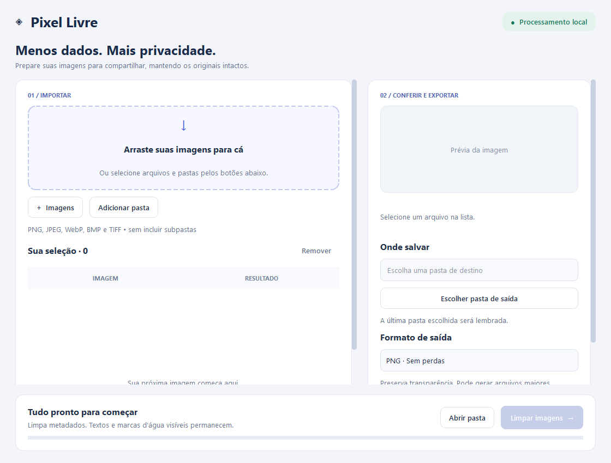

# Pixel Livre

[](https://github.com/BrunoRS17/pixel-livre/actions/workflows/tests.yml)

**Seus pixels ficam. Os metadados vão.**

Pixel Livre é um aplicativo desktop em Python para remover metadados embutidos de imagens em lote. Com uma interface em português, permite selecionar arquivos, conferir uma prévia e salvar cópias limpas em poucos cliques, preservando os originais. Todo o processamento acontece localmente, sem enviar imagens para servidores.

**Versão 0.2.0:** [release e download do código-fonte](https://github.com/BrunoRS17/pixel-livre/releases/tag/v0.2.0) · [histórico de mudanças](CHANGELOG.md). Este release não inclui um executável independente.

## Recursos

- Interface moderna em PySide6, com painéis de importação e exportação.
- Arrastar e soltar imagens ou pastas do Explorador de Arquivos.
- Escolha da pasta de saída, lembrada na próxima abertura do aplicativo.
- Seleção de várias imagens ou de uma pasta inteira.
- Prévia com dimensões e tamanho do arquivo.
- Remoção de EXIF, GPS, XMP e comentários embutidos por recriação dos pixels.
- Correção da orientação EXIF antes da limpeza.
- Exportação em PNG, JPEG ou WebP.
- Barra de progresso, resultado por arquivo e cancelamento do lote.
- Cópias com nomes exclusivos, sem sobrescrever os arquivos existentes.

## Instalação no Windows

### 1. Prepare o Python

Instale **Python 3.11 ou superior (64 bits)** pelo [site oficial do Python](https://www.python.org/downloads/windows/), marcando a opção de adicionar Python ao PATH. A interface usa Qt/PySide6; Tcl/Tk não é necessário.

### 2. Baixe o projeto

Nesta página do GitHub, clique em **Code → Download ZIP** e extraia a pasta. Abra um terminal dentro da pasta extraída, onde está o arquivo `requirements.txt`.

Para baixar exatamente a versão 0.2.0, use **Source code (zip)** na página do release. O download pelo botão Code acompanha a versão atual de `main`.

### 3. Instale as dependências

```powershell
python -m venv .venv
.\.venv\Scripts\python.exe -m pip install -r requirements.txt
```

Se o comando `python` não for reconhecido, use `py` no primeiro comando. Não é necessário ativar o ambiente virtual.

### 4. Abra o aplicativo

Dê dois cliques em **Iniciar.bat** ou execute:

```powershell
.\.venv\Scripts\python.exe app.py
```

O iniciador usa preferencialmente o ambiente `.venv` do projeto. A distribuição contém código Python e requer a instalação acima; não inclui um executável independente. Esta versão foi validada no Windows. Também é possível iniciar com `python -m pixel_livre` no ambiente preparado.

**Atualizando uma instalação anterior:** execute novamente `.\.venv\Scripts\python.exe -m pip install -r requirements.txt` para instalar a nova dependência da interface.

## Interface



## Como usar

1. Arraste uma ou mais imagens para a área tracejada. Você também pode arrastar uma pasta ou clicar em **+ Imagens** / **Adicionar pasta**. Subpastas não são incluídas.
2. Selecione uma imagem na lista para ver a prévia. Use Ctrl ou Shift para selecionar várias e removê-las da lista.
3. No painel **Onde salvar**, clique em **Escolher pasta de saída**. Também é possível digitar um caminho; pastas inexistentes serão criadas durante a limpeza. Escolha o formato logo abaixo.
4. Clique em **Limpar imagens** e acompanhe o resultado de cada arquivo.
5. Clique em **Abrir pasta** para acessar as cópias.

Arquivos duplicados e extensões incompatíveis são ignorados com um resumo na tela. Nomes com espaços e acentos são aceitos. O arrastar e soltar recebe arquivos locais, não links de páginas web. A tecla **Delete**, com foco na lista, remove a seleção sem apagar arquivos do disco.

A última pasta de saída e o formato são salvos nas preferências locais do usuário (QSettings; no Windows, `HKEY_CURRENT_USER\Software\PixelLivre\PixelLivre`). Nenhum histórico de imagens é armazenado. No primeiro uso, o destino sugerido é a subpasta **Imagens limpas**, junto da primeira imagem.

As saídas recebem `_limpa` no nome e um número quando necessário. Nenhum arquivo existente é substituído. Cancelar mantém as cópias já salvas e aguarda a conclusão da imagem atual. Repetir a limpeza gera novas cópias de toda a lista. Se houver erro, selecione a imagem para ler os detalhes na lateral.

## Formatos e limites

- Entrada: PNG, JPEG, WebP, BMP e TIFF de uma única página/quadro.
- Saída PNG: preserva os pixels convertidos e a transparência, mas pode gerar arquivos maiores.
- Saída WebP: compressão sem perdas e transparência.
- Saída JPEG: qualidade 95, com recompressão e transparência substituída por branco.
- Aplica a orientação EXIF antes de remover os metadados.
- Recria os pixels em RGB/RGBA sem copiar EXIF, GPS, XMP, comentários ou perfil ICC. Imagens de alta profundidade são convertidas para 8 bits por canal; perfis de cor removidos podem alterar a aparência em visualizadores.
- Imagens animadas e TIFF com várias páginas são rejeitados para evitar perda silenciosa de quadros.
- Não remove marcas d’água, textos, informações visíveis nos pixels ou dados esteganográficos. Não é uma ferramenta de anonimização completa nem um validador de credenciais C2PA. A recriação não preserva as credenciais embutidas, mas não garante remover vínculos externos de procedência.

## Verificação

Instale as dependências de desenvolvimento e execute a suíte pytest:

```powershell
.\.venv\Scripts\python.exe -m pip install -r requirements-dev.txt
.\.venv\Scripts\python.exe -m pytest
```

Para medir cobertura de linhas e ramificações:

```powershell
.\.venv\Scripts\python.exe -m pytest --cov=pixel_livre --cov-report=term-missing --cov-report=html
```

Os testes cobrem remoção de metadados, orientação, transparência, preservação do original, nomes exclusivos, rejeição de arquivos corrompidos/animados, importação e deduplicação, cancelamento, eventos Qt de arrastar e soltar, persistência do destino e fluxo de limpeza pela interface. Os testes Qt usam renderização offscreen e preferências temporárias; não alteram as configurações do usuário.

Na validação local da versão 0.2.0, **35 testes passaram**, com **91% de cobertura combinada de linhas e ramificações**, em Windows, Python 3.12 e PySide6 6.12. A cobertura inclui layout e interface; não equivale a uma garantia de ausência de erros nem a uma auditoria completa de metadados.

O GitHub Actions executa os testes em Windows com Python **3.11, 3.12 e 3.13** a cada push em `main` ou pull request. A integração exige ao menos **85% de cobertura**, e disponibiliza relatórios JUnit e XML por 14 dias. Consulte [o guia de testes](docs/TESTES.md) para filtros, fixtures, limitações e diagnóstico.

## Stack e motivos das escolhas

| Tecnologia | Onde usamos | Por que foi escolhida e qual o compromisso |
| --- | --- | --- |
| **Python 3.11+** | Aplicação e núcleo | Permite reaproveitar o script original, usar tipos e organizar serviços pequenos. A distribuição atual exige um interpretador instalado. A matriz de CI cobre 3.11–3.13. |
| **Pillow** | Leitura, orientação, conversão e recriação dos pixels | Mantém a lógica de imagem em uma biblioteca só e suporta os formatos de entrada adotados. JPEG é recodificado; perfis ICC e alta profundidade não são preservados. Não substitui um validador de C2PA. |
| **PySide6 Essentials / Qt Widgets** | Interface desktop e arrastar/soltar | Oferece controles, layouts, sinais e eventos de arquivos em uma única biblioteca. Substitui Tkinter para facilitar a evolução da interface. Essentials evita exigir módulos de navegador/multimídia, embora Qt ainda aumente o tamanho da instalação. |
| **QThread + sinais Qt** | Execução dos lotes | Mantém o processamento fora da thread da interface e entrega resultados à janela. O lote é sequencial para limitar o consumo de memória; não busca paralelizar várias imagens. |
| **threading.Event** | Cancelamento cooperativo | Permite interromper o início das próximas imagens sem matar a gravação em andamento. É parte da biblioteca padrão. |
| **QSettings** | Pasta de saída e formato | Usa o armazenamento de configurações do sistema, sem precisar de banco de dados. Nos testes, recebe um INI temporário para não tocar nas preferências reais. |
| **pathlib + dataclasses** | Caminhos e resultados de importação/processamento | São recursos da biblioteca padrão que deixam os contratos explícitos e o núcleo independente da interface. |
| **Qt Style Sheets + Fusion** | Tema visual | Centralizam cores, espaçamento e estados dos componentes sem adicionar uma biblioteca de temas. O layout ainda precisa de revisão visual em escalas de tela diferentes. |
| **pytest** | Suíte automatizada | Fixtures isolam dados; parametrização verifica diferentes formatos; asserts produzem diagnósticos legíveis. Substitui os testes anteriores baseados em unittest. |
| **pytest-qt** | Testes da interface | Gerencia QApplication, widgets e espera por condições no loop de eventos. Evita esperas fixas para acompanhar o worker. Não reproduz sozinho a interação real com o Explorador do Windows. |
| **pytest-cov / coverage.py** | Relatórios e limite mínimo na CI | Mede código e ramificações exercitados e ajuda a identificar lacunas. Cobertura não avalia a qualidade visual nem prova remoção de todos os metadados possíveis. |
| **GitHub Actions** | Validação de cada atualização | Reproduz os testes em diferentes versões de Python e guarda relatórios. O workflow tem apenas permissão de leitura e não publica releases automaticamente. |
| **venv + pip + requirements** | Instalação e isolamento | Mantêm o fluxo simples para um aplicativo pequeno. Dependências de uso e desenvolvimento ficam separadas; os intervalos de versão permitem atualizações, sem constituir um lockfile reproduzível. |
| **PowerShell / BAT** | Inicialização no Windows | Permitem abrir o ambiente preparado com dois cliques. São iniciadores, não instaladores nem executáveis empacotados. |

Não há serviço web, conta obrigatória, banco de dados, modelo de IA ou envio de imagens para terceiros. ExifTool, OCR e empacotamento com PyInstaller não fazem parte desta versão.

Referências: [Python](https://docs.python.org/3/), [Pillow](https://pillow.readthedocs.io/), [Qt for Python](https://doc.qt.io/qtforpython-6/), [pytest](https://docs.pytest.org/), [pytest-qt](https://pytest-qt.readthedocs.io/), [pytest-cov](https://pytest-cov.readthedocs.io/), [GitHub Actions](https://docs.github.com/en/actions).

## Estrutura

| Arquivo | Função |
| --- | --- |
| `app.py` | Ponto de entrada compatível com o iniciador |
| `pixel_livre/application.py` | Composição da aplicação |
| `pixel_livre/core/` | Limpeza, importação e processamento de lotes sem dependência de Qt |
| `pixel_livre/ui/` | Layout, componentes, tema, controlador e adaptador de execução em segundo plano |
| `pixel_livre/settings.py` | Preferências locais de exportação |
| `cleaner.py` | Compatibilidade com a API original de limpeza |
| `Iniciar.bat` / `iniciar.ps1` | Inicialização no Windows |
| `requirements.txt` | Dependências do projeto (Pillow e PySide6 Essentials) |
| `requirements-dev.txt` | Dependências adicionais de testes |
| `pyproject.toml` | Configuração de pytest e cobertura |
| `.github/workflows/tests.yml` | Matriz de testes no GitHub Actions |
| `tests/` | Testes de processamento e integração Qt |

Veja [a documentação da arquitetura](docs/ARQUITETURA.md) para entender responsabilidades, fluxo de dados e como evoluir o projeto.

## Problemas comuns

- **Python não encontrado:** reinstale Python com a opção PATH ou use `py` para criar o ambiente.
- **Pillow não encontrado:** execute novamente a instalação de `requirements.txt` usando o Python da `.venv`.
- **PySide6 não encontrado:** atualize as dependências com o comando da etapa 3 e abra usando o Python da `.venv`.
- **Arrastar não funciona:** solte arquivos locais na área tracejada. No Windows, evite executar o aplicativo como administrador quando o Explorador estiver sem elevação. Durante a limpeza a importação fica desabilitada.
- **Não foi possível salvar:** escolha uma pasta em que seu usuário tenha permissão de escrita.
- **Imagem rejeitada:** selecione o arquivo na lista e leia o erro na lateral; animações e arquivos com várias páginas não são aceitos.

## Contribuições

Sugestões e relatos de problemas são bem-vindos nas Issues. Inclua a versão do Python, o formato da imagem e a mensagem de erro. Evite anexar imagens com dados pessoais; prefira um exemplo fictício que reproduza o problema.

Antes de enviar uma contribuição, instale `requirements-dev.txt`, execute `python -m pytest` e inclua testes para mudanças de comportamento. Siga [a arquitetura](docs/ARQUITETURA.md) para manter o processamento separado da apresentação.
